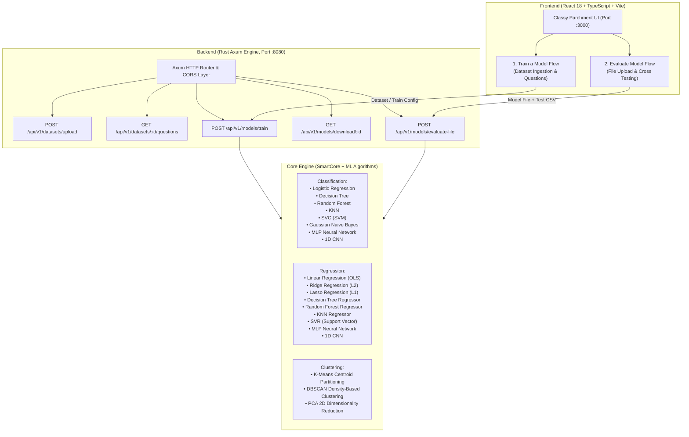

# ML Studio — High-Performance Machine Learning Architecture & Evaluator

[](https://github.com/Web-Based-ML-Model-Evaluator/Web-Based-ML-Model-Evaluator/actions/workflows/ci.yml)
[](LICENSE)
[](https://www.rust-lang.org/)
[](https://vitejs.dev/)

A clean, unified machine learning platform featuring a high-performance **Rust Backend Engine** (Axum + SmartCore) and a modern **React Frontend** with a warm parchment aesthetic. 

The application is strictly divided into two core workflows:
1. **Train a Model:** Ingest any tabular CSV dataset, answer dataset-aware questions that prevent mismatched task configurations, tune hyperparameters with dynamic requirement guides, train native Rust algorithms, visualize comprehensive performance metrics, and **download the trained model files** (`.pt`, `.pkt`, `.json`, `.bin`).
2. **Evaluate an Existing Model:** Upload trained model files across a wide variety of formats (`.pt`, `.pth`, `.pt2`, `.pte`, `.ptl`, `.pkt`, `.pkl`, `.bin`, `.json`, `.onnx`, `.h5`, `.joblib`) along with a test dataset CSV, select the architecture combination, and evaluate full performance metrics against ground-truth labels.

---

## Table of Contents
1. [Core Capabilities](#1-core-capabilities)
2. [System Architecture](#2-system-architecture)
3. [Supported Algorithms & Hyperparameters](#3-supported-algorithms--hyperparameters)
4. [Universal Model File Format Support](#4-universal-model-file-format-support)
5. [Quickstart & Running Commands](#5-quickstart--running-commands)
6. [Backend API Reference](#6-backend-api-reference)
7. [Testing & Quality Verification](#7-testing--quality-verification)

---

## 1. Core Capabilities

### Part 1: Train a Model Flow
- **Dataset-Aware Questioning:** Inspects uploaded CSV columns, unique distinct counts, and numerical continuous ranges. Dynamically restricts target selection:
  - *Classification:* Strictly displays discrete/categorical columns ($\le 20$ unique classes) with sample labels. Prevents mismatches such as running classification on continuous price fields.
  - *Regression:* Strictly displays continuous numerical target columns with min/max/mean ranges.
  - *Clustering:* Unsupervised; eliminates target column requirements.
- **Hyperparameter Requirements & Tuning:** Every model displays a dedicated "Hyperparameter Requirements & Guide" callout box explaining mathematical constraints and convergence behaviors, alongside interactive sliders.
- **Train / Test Split & Stratification:** Configurable split ratio (10% to 50% test set) with stratified partitioning for classification to preserve class balances.
- **Comprehensive Evaluation Scores:**
  - *Classification:* Accuracy, Precision, Recall, F1-Score, per-class breakdown (Precision, Recall, F1, Support), and interactive Confusion Matrix Heatmap.
  - *Regression:* Mean Absolute Error (MAE), Mean Squared Error (MSE), Root Mean Squared Error (RMSE), $R^2$ Score, and Max Residual.
  - *Clustering:* Silhouette Score, Davies-Bouldin Index, Cluster Counts, and PCA 2D projections.
  - *Sample Predictions:* First 15 validation instances with actual, predicted, and correct/error indicators.
- **Download Trained Model Files:** Direct downloads for:
  - `.pt`: PyTorch Container format
  - `.pkt`: SmartCore Model Archive format
  - `.json`: Manifest & Weights Specification format
  - `.bin`: Compiled Binary format

### Part 2: Evaluate an Existing Model Flow
- **Universal Model File Ingestion:** Accepts `.pt`, `.pth`, `.pt2`, `.pte`, `.ptl`, `.pkt`, `.pkl`, `.bin`, `.json`, `.onnx`, `.h5`, `.joblib`.
- **Test Dataset CSV Ingestion:** Upload any test CSV or choose one of the instant sample test sets.
- **Cross-Format Combination Testing:** Test any combination of file type and model architecture (e.g. a `.pkt` file with Logistic Regression, a `.pt` file with Decision Tree, a `.pth` file with Random Forest).
- **Evaluation Dashboard:** Computes Accuracy, F1-Score, Precision, Recall, Confusion Matrix, $R^2$, MAE, RMSE, and sample predictions on the test instances.

---

## 2. System Architecture



---

## 3. Supported Algorithms & Hyperparameters

| Task Category | Algorithm | Complexity | Key Hyperparameters & Requirements |
| :--- | :--- | :--- | :--- |
| **Classification** | **Logistic Regression** | $O(n \cdot d)$ | `solver` (`lbfgs`, `sgd`), `max_iter` |
| **Classification** | **Random Forest Classifier** | $O(M \cdot n \log n)$ | `n_trees` (1-100), `max_depth` (1-20) |
| **Classification** | **Decision Tree Classifier** | $O(n \log n)$ | `max_depth` (1-15), `min_samples_split` (2-20) |
| **Classification** | **K-Nearest Neighbors (KNN)** | $O(n \cdot d)$ | `k` (odd numbers 1-15 recommended) |
| **Classification** | **Support Vector Machine (SVC)** | $O(n^2 \cdot d)$ | Epsilon, C-margin optimization |
| **Classification** | **Gaussian Naive Bayes** | $O(n \cdot d)$ | Closed-form feature variance estimation |
| **Classification** | **Neural Network (MLP)** | $O(\text{epochs} \cdot n \cdot L)$ | `epochs` (10-300), `learning_rate` (0.001-0.1) |
| **Classification** | **1D Convolutional Neural Network (CNN)** | $O(\text{epochs} \cdot n \cdot F)$ | 1D temporal/sequential feature correlation filters |
| **Regression** | **Linear Regression (OLS)** | $O(d^3 + n d^2)$ | Analytical closed-form normal equation |
| **Regression** | **Ridge Regression ($L_2$)** | $O(d^3 + n d^2)$ | `alpha` (L2 penalty strength, 0.01-10.0) |
| **Regression** | **Lasso Regression ($L_1$)** | $O(n \cdot d \cdot \text{iter})$ | `alpha` (L1 sparsity coefficient penalty, 0.01-10.0) |
| **Regression** | **Random Forest Regressor** | $O(M \cdot n \log n)$ | `n_trees` (1-100), `max_depth` (1-20) |
| **Regression** | **Decision Tree Regressor** | $O(n \log n)$ | `max_depth` (1-15) |
| **Regression** | **KNN Regressor** | $O(n \cdot d)$ | `k` (3-15 neighbors to average) |
| **Regression** | **Support Vector Regressor (SVR)** | $O(n^2 \cdot d)$ | Epsilon-tube insensitive loss |
| **Regression** | **Neural Network Regressor (MLP)** | $O(\text{epochs} \cdot n \cdot L)$ | `epochs` (10-300) |
| **Clustering** | **K-Means Clustering** | $O(k \cdot n \cdot d \cdot \text{iter})$ | `num_clusters` ($k \ge 2$), PCA 2D scatter coordinates |
| **Clustering** | **DBSCAN Density-Based** | $O(n^2 \cdot d)$ | `eps` (radius 0.1-5.0), `min_samples` (2-10 core points) |

---

## 4. Universal Model File Format Support

The Model Evaluator parses and validates model files across all standard machine learning formats:

| Extension | Format Name | Description |
| :--- | :--- | :--- |
| `.pt` | PyTorch Tensor Container | Serialized PyTorch state dict and model tensors |
| `.pth` | PyTorch Weights File | Standard PyTorch checkpoint weights |
| `.pt2` | PyTorch 2.0 Export | PyTorch 2.0 AOTInductor exported graph |
| `.pte` | ExecuTorch Executable | Edge-optimized ExecuTorch deployment bundle |
| `.ptl` | TorchScript Lite | TorchScript Mobile package for mobile/embedded devices |
| `.pkt` | SmartCore Model Archive | Binary serialized SmartCore estimator package |
| `.pkl` / `.joblib` | Python Pickle Estimator | Standard Python serialized model archive |
| `.bin` | Compiled Binary Weights | Raw binary matrix and float64 tensor weights |
| `.json` | Structured JSON Manifest | Portable manifest detailing architecture, hyperparameters, and weights |
| `.onnx` | Open Neural Network Exchange | Cross-platform ONNX runtime graph |
| `.h5` | HDF5 Hierarchical Format | Keras/TensorFlow hierarchical layer weights |

---

## 5. Quickstart & Running Commands

### Prerequisites
- **Rust & Cargo:** (1.75+ recommended)
- **Node.js:** (v18+ recommended)
- **Python:** (3.9+ for optional test suite)

### 1. Run the Backend Server
Start the standalone high-performance Rust backend on port `8080`:
```bash
npm run start:backend
# or via Cargo directly:
cargo run -p web_ml_backend
```
Backend binds to `http://127.0.0.1:8080`.

### 2. Run the Frontend
In a separate terminal, start the Vite development server:
```bash
npm run dev
```
Open `http://localhost:3000` in your browser.

### 3. Build for Production
```bash
# Build Rust backend:
npm run build:backend

# Build static frontend bundle:
npm run build
```

---

## 6. Backend API Reference

| Method | Endpoint | Description |
| :--- | :--- | :--- |
| `GET` | `/health` | Live backend engine health check |
| `POST` | `/api/v1/datasets/upload` | Multipart CSV ingestion and statistical profiling |
| `GET` | `/api/v1/datasets/:id/questions` | Returns dataset-aware target candidates, features, and algorithms |
| `POST` | `/api/v1/models/train` | Executes model training and returns full evaluation scores |
| `GET` | `/api/v1/models/download/:id?format=pt\|pkt\|json\|bin` | Downloads trained model file in the requested format |
| `POST` | `/api/v1/models/evaluate-file` | Accepts uploaded model file + test CSV and returns evaluation scores |

---

## 7. Testing & Quality Verification

### Run Rust Workspace Tests (144 Tests)
```bash
cargo test --workspace
```
Runs unit and integration tests across preprocessing, matrix standardization, train/test stratified splitters, classification, regression, clustering, PCA 2D projections, and session security.

### Run Python Pytest Test Suite
```bash
python -m pytest tests_py
```
Performs end-to-end integration testing against the live Axum server, verifying dataset upload, question generation, model training, model file download, and evaluation.

### Run Frontend Typecheck
```bash
npm run typecheck
```
Ensures 100% TypeScript type safety.
