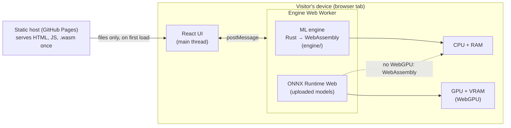
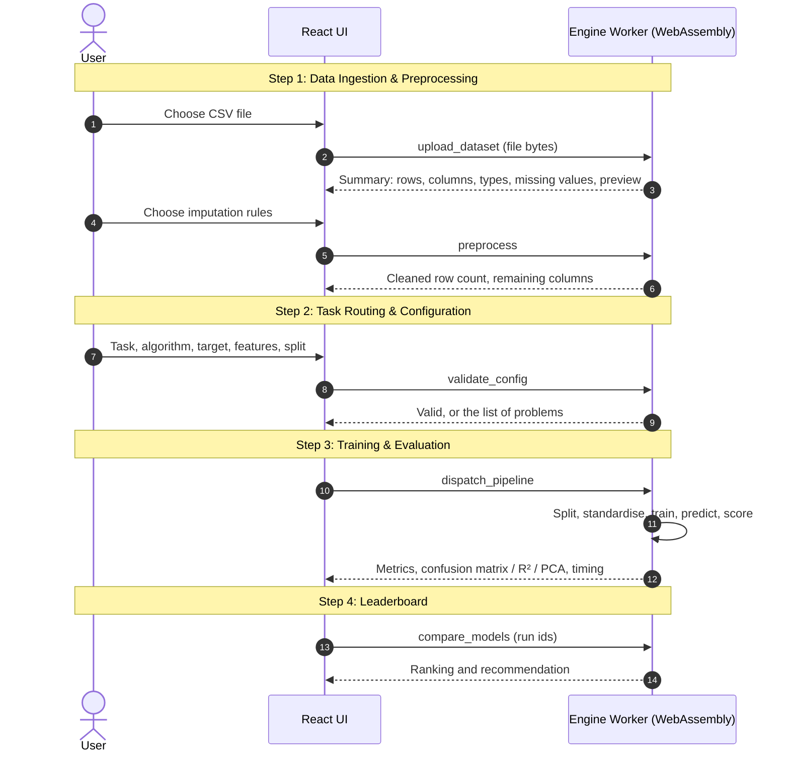
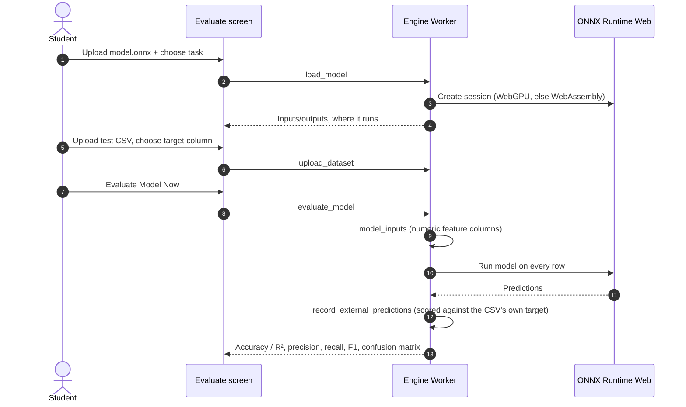

# ML Lab — Web-Based ML Model Evaluator

[](https://github.com/Web-Based-ML-Model-Evaluator/Web-Based-ML-Model-Evaluator/actions/workflows/ci.yml)
[](https://github.com/Web-Based-ML-Model-Evaluator/Web-Based-ML-Model-Evaluator/actions/workflows/cd.yml)

> **Train and evaluate machine learning models entirely in your browser, on your own device.**
> The Rust ML engine is compiled to WebAssembly and runs in a Web Worker; uploaded ONNX models run on your GPU through WebGPU. The web server only delivers the files: no dataset, model or result ever leaves your device.

**Live site:** https://web-based-ml-model-evaluator.github.io/Web-Based-ML-Model-Evaluator/

---

## Table of Contents

1. [Summary](#1-summary)
2. [Key Capabilities & Feature Matrix](#2-key-capabilities--feature-matrix)
3. [System Architecture](#3-system-architecture)
   - [3.1 What runs where](#31-what-runs-where)
   - [3.2 In-memory pipeline](#32-in-memory-pipeline)
   - [3.3 GPU use (WebGPU)](#33-gpu-use-webgpu)
4. [End-to-End Workflows](#4-end-to-end-workflows)
   - [4.1 Workflow A: 4-Step Model Training Wizard](#41-workflow-a-4-step-model-training-wizard)
   - [4.2 Workflow B: Evaluate an Uploaded Model](#42-workflow-b-evaluate-an-uploaded-model)
5. [Technology Stack](#5-technology-stack)
6. [Engine API](#6-engine-api)
7. [Directory Structure](#7-directory-structure)
8. [Testing & CI](#8-testing--ci)
9. [Getting Started](#9-getting-started)
10. [Deployment](#10-deployment)
11. [Browser Requirements](#11-browser-requirements)
12. [Consolidated Documentation](#12-consolidated-documentation)

---

## 1. Summary

**ML Lab** lets students, educators and data scientists train machine learning models on their own CSV data and evaluate models they trained elsewhere, without installing anything.

When you open the site, your browser downloads the application once: a React interface plus the ML engine, written in **Rust** and compiled to **WebAssembly**. From then on every step (parsing the CSV, cleaning it, training, scoring, comparing) runs **on your device**, in your browser tab's memory. The site keeps working even if you go offline after it has loaded.

### Core points
- **No backend processing.** The server is a static file host (GitHub Pages). There are no API calls during use.
- **Your data stays local.** Datasets and results live only in the tab's memory (SEC-1); closing the tab or clicking **Purge RAM** discards them (SEC-3).
- **Two journeys:**
  - *Train a Model:* a guided 4-step wizard (Ingestion → Task Routing → Training & Metrics → Leaderboard).
  - *Evaluate a Model:* upload a trained **ONNX** model and a test CSV to get its real accuracy / R² on your data.
- **Honest results.** Every metric comes from a model that actually ran; missing data, invalid columns or unsupported files produce clear errors instead of placeholder numbers.
- **Interactive explanations** (`InfoTooltip`) on every metric and parameter.

---

## 2. Key Capabilities & Feature Matrix

| ID | Requirement Area | Capability & Implementation Details |
| :--- | :--- | :--- |
| **FR-1** | Dataset Upload | CSV files up to 10 MB parsed on-device (RFC 4180, UTF-8 checks, filename sanitisation). |
| **FR-2** | Preview & Summary | Column type inference (`Numeric` / `Categorical`), missing value counts and percentages, 5-row preview. |
| **FR-3** | Imputation & Cleaning | Per-column **Mean**, **Median**, **Mode**, **Constant**, **Drop rows** or **Drop column**; duplicate removal and whitespace trimming. Datasets with gaps must be cleaned before training. |
| **FR-4** | Task Selection | **Classification**, **Regression** and **Clustering**, each with its compatible algorithms. |
| **FR-5** | Features & Targets | Feature/target selection with validation (target can't be a feature; columns must exist and be numeric). |
| **FR-6** | Clustering Parameters | K-Means with an explicit number of clusters (k ≥ 2). |
| **FR-7** | Train/Test Split | 5%–50% test split (default 20%). Classification uses stratified splitting to preserve class proportions; regression and clustering use a repeatable shuffle (`split_shuffled`). |
| **FR-8** | Model Execution | Logistic/Linear Regression, Decision Trees, Random Forests, KNN (smartcore), plus in-tree MLP and 1D CNN networks. |
| **FR-9** | Classification Metrics | Accuracy, macro Precision / Recall / F1 and an N × N confusion matrix (counts or percentages). |
| **FR-10** | Regression Metrics | MAE, MSE, RMSE and R². |
| **FR-11** | Clustering Metrics | Silhouette score, Davies-Bouldin index and a 2D PCA projection (PC1 vs PC2). |
| **FR-12** | Model Leaderboard | Side-by-side ranking of runs of the same task by their primary metric. |
| **FR-13** | Structured Errors | Every failure returns `{ error: { code, message, module, timestamp } }`. |
| **#46** | Uploaded Models | `.onnx` models run on-device with ONNX Runtime Web (WebGPU, or WebAssembly on the CPU). Other formats get advice on exporting to ONNX. |
| **#35 / #36** | MLP & 1D CNN | Pure-Rust multi-layer perceptron and 1D convolutional network with backpropagation. |
| **NFR-1** | Latency Budget | Runs over 30 s are reported as `PIPELINE_LATENCY_EXCEEDED`. |
| **NFR-2** | Portability | Any modern browser on Windows, macOS or Linux; nothing to install. |
| **SEC-1 / SEC-3** | Memory isolation | All state lives in one browser tab and is cleared by **Purge RAM** or by closing the tab. |

---

## 3. System Architecture

### 3.1 What runs where



- **Static host:** delivers `index.html`, the JavaScript bundle and the engine's `.wasm` file. It does no computation.
- **UI (main thread):** `frontend/src` — React views. They call the engine through `services/api.ts`.
- **Engine worker:** `frontend/src/engine/engine.worker.ts` loads the WebAssembly engine once and keeps the session (datasets, cleaned data, results) in its memory. Training runs here, so the page never freezes.
- **Rust engine:** `engine/` — preprocessing, validation, algorithms, metrics and the leaderboard, exposed through one `Session` API (see [Engine API](#6-engine-api)).
- **ONNX Runtime Web:** loaded into the same worker only when a model is uploaded.

### 3.2 In-memory pipeline

```
[CSV file] ─> [Validate & parse] ─> [Impute / clean] ─> [Cleaned data in worker memory]
                                                               │
   ┌───────────────────────────────────────────────────────────┘
   ▼
[Validate config] ─> [Split (stratified / shuffled)] ─> [Standardise] ─> [Train & predict]
                                                               │
   ┌───────────────────────────────────────────────────────────┘
   ▼
[Metrics] ─> [Comparison store] ─> [Leaderboard]
```

Nothing is serialised to disk or sent over the network at any step. If the engine ever hits an unrecoverable error (a WebAssembly trap), the page restarts the worker and tells the user the session was reset.

### 3.3 GPU use (WebGPU)

- **Uploaded ONNX models** run through ONNX Runtime Web's **WebGPU** backend when the browser offers it, so the model's tensors live in GPU memory (VRAM). Without WebGPU they run on the CPU through WebAssembly. The results screen shows which one was used.
- **Built-in models** (smartcore, MLP, CNN) train on the **CPU** in WebAssembly, single-threaded.
- The **Your Device** panel shows CPU threads, approximate RAM and the GPU exactly as the browser reports them. Browsers do not reveal total VRAM, so none is shown. Its **Measure GPU vs CPU** button runs a real WGSL compute shader (a point-to-center distance matrix) and the same computation in JavaScript, and reports both measured times.

---

## 4. End-to-End Workflows

### 4.1 Workflow A: 4-Step Model Training Wizard



### 4.2 Workflow B: Evaluate an Uploaded Model



The model must take a single `[rows, features]` float input with the CSV's numeric feature columns in file order. Label outputs, class-score/logit outputs (the highest score wins) and regression outputs are supported. When a model outputs class numbers but the target holds text labels, they are matched in sorted order and the mapping is shown.

PyTorch, scikit-learn and Keras models can be exported with `torch.onnx.export`, `skl2onnx` or `tf2onnx`. `.pt`, `.pkl`, `.joblib` and `.h5` files need Python to run and are rejected with this advice.

---

## 5. Technology Stack

### 5.1 Engine (Rust → WebAssembly)

| Technology | Version | Purpose |
| :--- | :--- | :--- |
| **Rust** | stable, edition 2021 | Engine language; compiled to `wasm32-unknown-unknown`. |
| **wasm-bindgen** | `0.2.130` (pinned) | JavaScript bindings for the engine (`Engine.call`). |
| **smartcore** | `0.6` | Logistic/Linear Regression, Decision Trees, Random Forests, KNN. |
| **In-tree neural networks** | — | MLP and 1D CNN with backpropagation (`core/ml/nn.rs`). |
| **csv** | `1.3` | RFC 4180 CSV parsing. |
| **serde / serde_json** | `1.0` | Engine API messages and results. |
| **chrono, uuid, web-time** | — | Timestamps, run ids and timings that work in the browser. |

### 5.2 Frontend

| Technology | Version | Purpose |
| :--- | :--- | :--- |
| **React** | `18` | User interface. |
| **TypeScript** | `5` | Static typing. |
| **Vite** | `8` | Bundles the app, the worker and the `.wasm` files with relative paths. |
| **Web Workers** | — | Runs the engine off the main thread. |
| **ONNX Runtime Web** | `1.31.1` | Runs uploaded ONNX models (WebGPU / WebAssembly). Loaded on demand. |
| **WebGPU / WGSL** | — | GPU execution of ONNX models and the device benchmark. |

### 5.3 Security, Reliability & Memory Model

- **Data never leaves the device:** there is no backend to send it to. Files are read with the browser's File API and passed to the worker.
- **Volatile memory only (SEC-1 / SEC-3):** nothing is written to disk or browser storage; **Purge RAM** clears the worker's session and releases loaded models.
- **Determinism:** splits use a fixed seed (`SPLIT_SEED = 42`), so the same data and configuration give the same results.
- **Input limits:** 10 MB CSV cap (`FILE_TOO_LARGE`), at least 10 rows and 2 columns, sanitised filenames.
- **Failure handling:** errors are structured (FR-13). A WebAssembly trap restarts the worker instead of leaving a broken session.

---

## 6. Engine API

The engine has one entry point. The page calls `callEngine(method, args, bytes?)` (`frontend/src/engine/client.ts`), which posts a message to the worker; the worker calls `Session::call` in Rust (`engine/src/session.rs`). Results are JSON; failures reject with an `EngineError` carrying the FR-13 `code` and `message`.

See **[docs/API_SPECIFICATION.md](docs/API_SPECIFICATION.md)** for every method, its arguments and its result.

| Area | Methods |
| :--- | :--- |
| Datasets (FR-1 to FR-3) | `upload_dataset`, `preview`, `preprocess`, `schema`, `cleaned_data`, `purge_dataset`, `purge_session` |
| Task routing (FR-4 to FR-7) | `list_tasks`, `validate_config`, `dispatch_pipeline` |
| Execution & comparison (FR-8 to FR-12) | `execute_model`, `comparison_history`, `compare_models` |
| Uploaded models (#46) | `load_model`, `list_models`, `evaluate_model` (JavaScript, in the worker), backed by `model_inputs` and `record_external_predictions` (Rust) |

---

## 7. Directory Structure

```
Web-Based-ML-Model-Evaluator/
├── engine/                          # Rust ML engine (compiled to WebAssembly)
│   ├── Cargo.toml                   # cdylib (browser) + rlib (native tests)
│   ├── src/
│   │   ├── lib.rs                   # Crate root
│   │   ├── session.rs               # The engine API: in-memory Session + Session::call
│   │   ├── wasm.rs                  # wasm-bindgen wrapper exposing Engine.call to JavaScript
│   │   ├── core/
│   │   │   ├── validator.rs         # Upload checks, filename sanitisation, size rules
│   │   │   ├── preprocessing.rs     # CSV parsing, type inference, imputation
│   │   │   ├── router_validation.rs # Task / algorithm / column / split validation
│   │   │   ├── comparison_store.rs  # Run history and leaderboard ranking
│   │   │   └── ml/
│   │   │       ├── algorithms.rs    # Supervised models, K-Means, PCA, splits
│   │   │       ├── nn.rs            # MLP and 1D CNN
│   │   │       └── metrics.rs       # Classification, regression and clustering metrics
│   │   └── models/                  # Request/response types (datasets, routing,
│   │                                #   execution, comparison, evaluation, errors)
│   └── tests/                       # Integration tests of the public API
│
├── frontend/
│   ├── index.html
│   └── src/
│       ├── index.tsx, App.tsx       # Entry point and workflow coordinator
│       ├── engine/
│       │   ├── engine.worker.ts     # Loads the WebAssembly engine; routes messages
│       │   ├── client.ts            # Promise-based calls to the worker; EngineError
│       │   ├── onnx.ts              # ONNX Runtime Web: load and run uploaded models
│       │   ├── protocol.ts          # Worker message types
│       │   └── pkg/                 # Generated by `npm run build:engine` (not committed)
│       ├── services/
│       │   ├── api.ts               # App-facing engine client (same method names as before)
│       │   └── webgpu.ts            # Device info and the GPU vs CPU benchmark
│       ├── components/              # Navbar, Hero, Your Device panel, Steps 1-4, Evaluate screen
│       └── styles/theme.css
│
├── scripts/engine.mjs               # `build` (wasm + bindings) and `test` (cargo test)
├── .github/workflows/
│   ├── ci.yml                       # Engine tests + WebAssembly/frontend build
│   └── cd.yml                       # Static bundle → artifact + GitHub Pages
├── contracts/fixtures/              # Sample CSVs (classification, regression)
├── documents/                       # Team specifications (PDF)
├── vite.config.mjs                  # Relative paths, ES-module worker
├── Cargo.toml                       # Workspace (size-optimised release profile)
└── package.json                     # npm scripts
```

---

## 8. Testing & CI

```bash
npm test               # engine tests (cargo test --workspace): 133 tests
npm run build:engine   # compile the engine to WebAssembly + generate bindings
npm run typecheck      # tsc --noEmit (needs the engine built first)
npm run build          # build:engine + production bundle in dist/
```

The engine is plain Rust, so its tests run natively; the same code is what runs in the browser.

**CI** (`.github/workflows/ci.yml`, on pushes to `main`, `issue-**`, `feat/**` and on pull requests):
- **Engine:** `cargo check` (native and `wasm32`), `cargo test`, rustfmt and clippy (non-blocking).
- **Web bundle:** builds the WebAssembly engine, typechecks and builds the site.

---

## 9. Getting Started

To *use* ML Lab, just open the [live site](https://web-based-ml-model-evaluator.github.io/Web-Based-ML-Model-Evaluator/). To develop it locally:

### Prerequisites
- [Rust](https://rustup.rs/) (stable) with the WebAssembly target:
  ```bash
  rustup target add wasm32-unknown-unknown
  ```
- `wasm-bindgen-cli` at **exactly** the crate's version:
  ```bash
  cargo install wasm-bindgen-cli --version 0.2.130 --locked
  ```
- [Node.js](https://nodejs.org/) 20+

### Run it
```bash
git clone https://github.com/Web-Based-ML-Model-Evaluator/Web-Based-ML-Model-Evaluator.git
cd Web-Based-ML-Model-Evaluator
npm install
npm run build:engine   # re-run after changing anything in engine/
npm run dev            # http://localhost:3000
```

There is no backend to start. To test the production bundle: `npm run build`, then `npx vite preview` (http://localhost:4173).

> **Windows with Smart App Control:** SAC blocks the build scripts that Cargo compiles, so Rust builds fail with *"An Application Control policy has blocked this file"*. Build the engine from **WSL** (install Rust and `build-essential` there) and run the npm commands as usual.

Sample data for trying it out: `contracts/fixtures/sample_classification.csv` and `contracts/fixtures/sample_regression.csv`.

---

## 10. Deployment

The site is a static bundle, so any static host works.

- **GitHub Pages (automatic):** `.github/workflows/cd.yml` runs on every push to `main`. It builds the engine and frontend, uploads `dist/` as a downloadable artifact (`web-ml-static-site`) and deploys it to GitHub Pages. One-time setup: **Settings → Pages → Source: GitHub Actions**.
- **Any other host:** run `npm run build` (or download the CD artifact) and upload the contents of `dist/`. Assets use relative paths, so the site works from a sub-path. The host must serve `.wasm` files with the `application/wasm` MIME type (most do).
- **Multi-threading (optional):** static hosts like GitHub Pages can't send the cross-origin isolation headers that multi-threaded WebAssembly needs, so the engine runs single-threaded. On a host that sends `Cross-Origin-Opener-Policy: same-origin` and `Cross-Origin-Embedder-Policy: require-corp`, ONNX Runtime uses multiple threads automatically.

---

## 11. Browser Requirements

| Feature | Needed for | Support |
| :--- | :--- | :--- |
| WebAssembly + module Web Workers | Everything | All current Chrome, Edge, Firefox and Safari |
| WebGPU | Running ONNX models on the GPU, the GPU benchmark | Chrome / Edge 113+ (desktop); other browsers fall back to the CPU |

The app downloads about 0.3 MB (gzipped) for the engine. ONNX Runtime (about 7 MB gzipped) is downloaded only the first time a model is uploaded.

---

## 12. Consolidated Documentation

All team design documents and specifications are consolidated into a single bookmarked PDF:
- **Location:** [`documents/Team13_Consolidated_Documentation.pdf`](documents/Team13_Consolidated_Documentation.pdf)
- **Included sections:**
  1. *Functional Requirements Specification (FR-1 to FR-13)*
  2. *Software Requirements Specification (SRS Team 13)*
  3. *Software Architecture & System Design (Team 13 SASD)*
  4. *Software Test Plan & Quality Assurance (Test Plan Team 13)*

These documents describe the original server-based design; the architecture above reflects the current on-device implementation.

---

*Team 13 — Web-Based ML Model Evaluator.*
