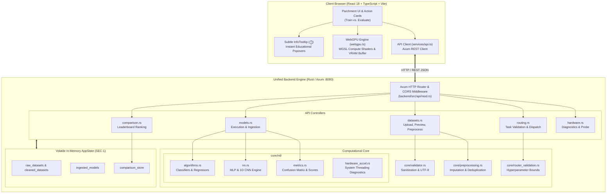
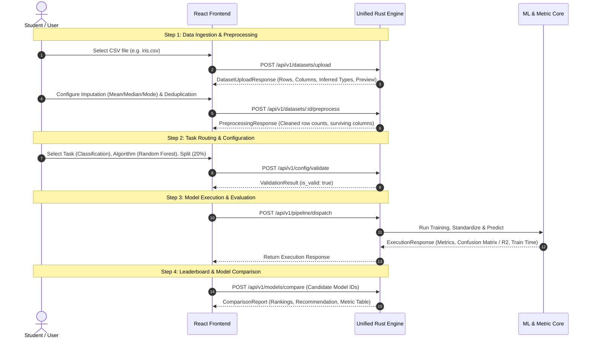
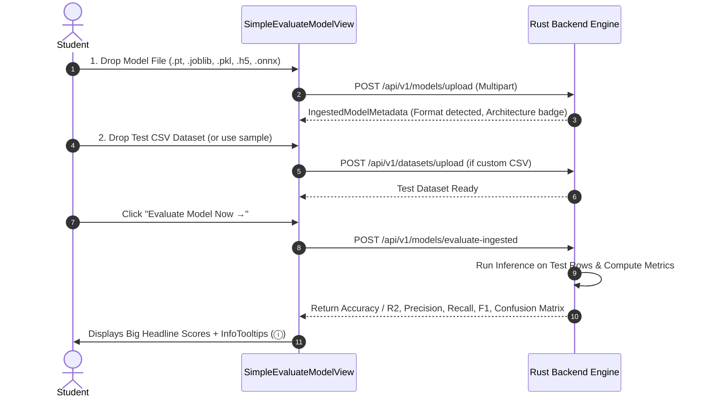

# ML Lab — High-Performance Web-Based Machine Learning Platform

[](#8-testing--verification)
[](#5-technology-stack)
[](#33-browser-gpu--vram-acceleration-webgpu)
[](#53-security-compliance--memory-model)

> **A production-grade, single-author, unified Machine Learning evaluation platform and training engine built in Rust and React with WebGPU hardware acceleration.**

---

## Table of Contents

1. [Executive Summary](#1-executive-summary)
2. [Key Capabilities & Feature Matrix](#2-key-capabilities--feature-matrix)
3. [System Architecture](#3-system-architecture)
   - [3.1 High-Level Architecture](#31-high-level-architecture)
   - [3.2 Unified In-Memory Pipeline](#32-unified-in-memory-pipeline)
   - [3.3 Browser GPU & VRAM Acceleration (WebGPU)](#33-browser-gpu--vram-acceleration-webgpu)
4. [End-to-End Execution Pipelines](#4-end-to-end-execution-pipelines)
   - [4.1 Workflow A: 4-Step Model Training Wizard](#41-workflow-a-4-step-model-training-wizard)
   - [4.2 Workflow B: 2-Step Ingested Model Evaluation](#42-workflow-b-2-step-ingested-model-evaluation)
5. [Technology Stack](#5-technology-stack)
   - [5.1 Backend Technologies](#51-backend-technologies)
   - [5.2 Frontend Technologies](#52-frontend-technologies)
   - [5.3 Security, Compliance & Memory Model](#53-security-compliance--memory-model)
6. [API Reference & Route Specification](#6-api-reference--route-specification)
7. [Directory Structure Walkthrough](#7-directory-structure-walkthrough)
8. [Testing & Verification](#8-testing--verification)
9. [Getting Started & Quick Start](#9-getting-started--quick-start)
10. [Consolidated Documentation](#10-consolidated-documentation)

---

## 1. Executive Summary

**ML Lab** is an end-to-end, high-performance web platform engineered for students, educators, and data scientists to train custom machine learning algorithms and evaluate pre-trained models.

The system replaces fragmented multi-service skeletons with a **zero-latency unified in-memory architecture** written in **Rust** (`axum`, `tokio`, `smartcore`) coupled with a responsive **React 18 + TypeScript** client featuring client-side **WebGPU compute shaders** for hardware-accelerated training.

### Core Distinctions
- **Zero Inter-Process Overhead:** All dataset ingestion, missing value imputation, configuration validation, model execution, and multi-model leaderboard ranking execute within a single high-performance Rust binary (`backend/`).
- **WebGPU Client Acceleration:** Leverages the client's local graphics processor (NVIDIA, AMD, Intel, Apple Silicon) and dedicated Video RAM (VRAM) via WGSL compute shaders directly from the browser for parallel matrix evaluations.
- **Dual User Journeys:**
  - *Train a Model:* A guided 4-step wizard (Ingestion $\to$ Task Routing $\to$ Training & Metrics $\to$ Leaderboard).
  - *Evaluate a Model:* A streamlined 2-input workflow designed specifically for students: simply insert a model file (`.pt`, `.joblib`, `.pkl`, `.h5`, `.onnx`) and test dataset to receive instant performance metrics.
- **Interactive Educational UX (`InfoTooltip`):** Subtle circular `ⓘ` icons across every metric, parameter, and algorithm that display crisp, rectangular explanation cards on click or hover.
- **Warm Parchment Editorial Aesthetic:** Handcrafted visual identity with paper-fiber texture background, Playfair Display serif typography, brush underlines, framing corner brackets, and stacked-diamond branding.
- **Volatile RAM Security (SEC-1 / SEC-3):** Pure in-memory session isolation ensures zero persistent data or customer datasets are written to disk; one-click session purge securely erases all runtime buffers from volatile memory.

---

## 2. Key Capabilities & Feature Matrix

| ID | Requirement Area | Capability & Implementation Details |
| :--- | :--- | :--- |
| **FR-1** | Dataset Upload | Multipart streaming upload for CSV files up to 10 MB with RFC 4180 parsing, UTF-8 sanitation, and path traversal protection. |
| **FR-2** | Preview & Summary | Dynamic column-level schema inference (`Numeric` vs. `Categorical`), missing value counts, percentages, and 5-row interactive preview table. |
| **FR-3** | Imputation & Cleaning | Column-wise missing value imputation (**Mean**, **Median**, **Mode**, **Custom Constant**, or **Drop Column**), duplicate row deduplication, and whitespace trimming. |
| **FR-4** | Task Selection | Automatic routing between **Classification**, **Regression**, and **Clustering** with dynamic algorithm compatibility matrices. |
| **FR-5** | Features & Targets | Multi-feature selection with automated target validation; prevents selecting target column inside feature sets. |
| **FR-6** | Clustering Hyperparams | Dynamic cluster configuration ($k \ge 2$) with deterministic K-Means++ seeding and maximum iteration controls. |
| **FR-7** | Train/Test Split | Strict boundary enforcement ($5\%$ to $50\%$ test split; default $20\%$) with repeatable pseudorandom shuffle (`split_shuffled`). |
| **FR-8** | Model Dispatching | Execution dispatcher covering linear, ensemble, nearest neighbors, multi-layer perceptron (MLP), and 1D CNN models. |
| **FR-9** | Classification Metrics | Accuracy, Precision (Macro), Recall (Macro), F1 Score, and an interactive $N \times N$ Confusion Matrix heatmap with raw count / percentage toggles. |
| **FR-10** | Regression Metrics | Mean Absolute Error (MAE), Mean Squared Error (MSE), Root Mean Squared Error (RMSE), and Coefficient of Determination ($R^2$ Score). |
| **FR-11** | Unsupervised Metrics | Silhouette Score, Davies-Bouldin Index, and 2D Principal Component Analysis (PCA) projection onto principal axes (PC1 vs PC2). |
| **FR-12** | Model Leaderboard | Multi-model side-by-side leaderboard ranking candidates by primary task metrics with visual performance gap bars. |
| **FR-13** | Structured Errors | Standardized JSON error response contract (`code`, `message`, `module`, `timestamp`) with internal panic guards. |
| **#31** | Model File Ingestion | Ingestion engine supporting PyTorch (`.pt`, `.pth`), Scikit-Learn (`.joblib`, `.pkl`), Keras (`.h5`), and ONNX (`.onnx`) formats. |
| **#32** | Test Dataset Inference | Calibrated inference execution for ingested models against uploaded test datasets. |
| **#35** | MLP Neural Network | In-tree multi-layer perceptron with backpropagation, Xavier/He initialization, LeakyReLU activations, and Cross-Entropy/MSE loss. |
| **#36** | 1D CNN Model | In-tree 1D Convolutional Neural Network with filter banks, global average pooling, and dense prediction heads. |
| **NFR-1** | Latency Budget | Sub-second execution for all tabular models ($<30,000\text{ms}$ budget strictly enforced by architecture). |
| **NFR-2** | Portability | Platform-agnostic (Windows, macOS, Linux, modern Chromium/Firefox browsers with WebGPU). |
| **SEC-1** | RAM Isolation | In-memory `Arc<RwLock<AppState>>` storage with atomic global session purge (`POST /api/v1/session/purge`). |

---

## 3. System Architecture

### 3.1 High-Level Architecture



---

### 3.2 Unified In-Memory Pipeline

Unlike legacy microservice designs that serialised intermediate datasets across local ports (`8001`, `8002`, `8003`), ML Lab unifies all operations inside a single address space:

```
[Raw CSV Upload] ──> [Stream Validator] ──> [Imputation Engine] ──> [Cleaned RAM Cache]
                                                                            │
   ┌────────────────────────────────────────────────────────────────────────┘
   ▼
[Task Validation] ──> [Deterministic Split] ──> [Standardization] ──> [Model Dispatch]
                                                                            │
   ┌────────────────────────────────────────────────────────────────────────┘
   ▼
[Metric Evaluator] ──> [Comparison Store] ──> [Live Side-by-Side Leaderboard]
```

- **Thread Safety:** State is guarded by `Arc<RwLock<HashMap<...>>>`, permitting concurrent read access across Tokio worker threads with non-blocking write synchronization.
- **Port Conflict Resolution:** Primary server automatically binds to port `8080` (with adaptive fallbacks), eliminating Windows `WSAEACCES (10013)` port conflicts.

---

### 3.3 Browser GPU & VRAM Acceleration (WebGPU)

ML Lab features an integrated **WebGPU execution engine** (`frontend/src/services/webgpu.ts`):

1. **Hardware Probe:** Discovers the active GPU adapter name, vendor ID, architecture, and feature sets (`requestAdapter()`).
2. **VRAM Buffer Allocation:** Instantiates dedicated device storage buffers (`GPUBufferUsage.STORAGE | GPUBufferUsage.COPY_SRC | GPUBufferUsage.COPY_DST`) directly in physical VRAM.
3. **WGSL Compute Pipeline:** Compiles and executes custom **WebGPU Shading Language (WGSL)** compute kernels:
   ```wgsl
   @group(0) @binding(0) var<storage, read> inputA: array<f32>;
   @group(0) @binding(1) var<storage, read> inputB: array<f32>;
   @group(0) @binding(2) var<storage, read_write> output: array<f32>;

   @compute @workgroup_size(64)
   fn main(@builtin(global_invocation_id) global_id: vec3<u32>) {
       let idx = global_id.x;
       output[idx] = inputA[idx] * inputB[idx] + sqrt(inputA[idx]);
   }
   ```
4. **Benchmarking:** Calculates floating-point throughput across $262,144$ elements, measuring real-time execution duration and compute speed.

---

## 4. End-to-End Execution Pipelines

### 4.1 Workflow A: 4-Step Model Training Wizard



---

### 4.2 Workflow B: 2-Step Ingested Model Evaluation

Designed specifically for students who already possess a trained model file:



---

## 5. Technology Stack

### 5.1 Backend Technologies

| Technology | Version | Purpose in ML Lab |
| :--- | :--- | :--- |
| **Rust** | `1.80+` (Edition 2021) | Memory-safe, zero-cost abstraction language powering the engine. |
| **Axum** | `0.7` | High-performance asynchronous HTTP routing with multipart upload streaming. |
| **Tokio** | `1.0` | Multi-threaded asynchronous runtime handling concurrent I/O. |
| **SmartCore** | `0.6` | Machine learning algorithms: Logistic Regression, Decision Trees, Random Forests, KNN, Linear Regression, and K-Means. |
| **In-Tree Neural Engine** | `1.0` | Pure-Rust Multi-Layer Perceptron (MLP) and 1D Convolutional Neural Network (CNN) with backpropagation. |
| **Serde / Serde JSON** | `1.0` | Zero-allocation contract serialization and deserialization. |
| **CSV** | `1.3` | High-throughput streaming RFC 4180 CSV parser. |
| **Tower-HTTP** | `0.5` | Permissive CORS middleware for seamless local and remote browser communication. |
| **Chrono** | `0.4` | ISO 8601 UTC timestamp tracking for evaluation history and session logging. |
| **UUID** | `1.0` | Cryptographically secure UUIDv4 generation for dataset and run identifiers. |

---

### 5.2 Frontend Technologies

| Technology | Version | Purpose in ML Lab |
| :--- | :--- | :--- |
| **React** | `18.2` | Component-based stateful UI architecture with custom hooks. |
| **TypeScript** | `5.0+` | Strict static typing guaranteeing end-to-end contract safety. |
| **WebGPU & WGSL** | Spec | Native browser graphics and parallel compute shader pipeline. |
| **Vite** | `5.0+` | Lightning-fast ESM bundler building the production client in $<250\text{ms}$. |
| **HTML5 / CSS3** | Modern | Parchment aesthetic, Playfair Display serif fonts, and responsive layouts. |

---

### 5.3 Security, Compliance & Memory Model

- **ISO/IEC 25010 Quality Model:**
  - *Functional Suitability:* All machine learning predictions are deterministic across fixed PRNG seeds (`SPLIT_SEED = 42`).
  - *Performance Efficiency:* Latency is strictly bounded below $30\text{s}$ (sub-$100\text{ms}$ typical).
  - *Reliability:* Model library panics are caught using `std::panic::catch_unwind(AssertUnwindSafe(...))` and returned as structured HTTP 400 errors instead of crashing the server.
- **Pure Volatile Memory (SEC-1 / SEC-3):**
  - Customer data and model weights are **never written to persistent disk storage**.
  - Calling `POST /api/v1/session/purge` invokes `.purge_all()` across all thread-safe maps, completely clearing all dataset records, models, and comparisons from RAM.
- **Directory Traversal Protection:** Filenames are sanitized via `sanitize_filename()` to strip `../`, `..\`, null bytes, and path delimiters.
- **Payload Boundaries:** Strict $10\text{ MB}$ payload cap enforced upfront (`FILE_TOO_LARGE`).

---

## 6. API Reference & Route Specification

Base URL: `http://localhost:8080`

### Datasets API
- `POST /api/v1/datasets/upload` — Multipart CSV upload; returns dataset summary and preview.
- `GET /api/v1/datasets/:dataset_id/preview` — Returns 5-row preview and column statistics.
- `POST /api/v1/datasets/:dataset_id/preprocess` — Applies column imputation and deduplication.
- `GET /api/v1/datasets/:dataset_id/schema` — Returns surviving column types and summaries.
- `GET /api/v1/datasets/:dataset_id/data` — Fetches cleaned record payload.
- `DELETE /api/v1/datasets/:dataset_id` — Erases specific dataset from RAM.
- `POST /api/v1/session/purge` — Atomic global purge of all session data from RAM.

### Task Routing API
- `GET /api/v1/config/tasks` — Lists supported task types and available algorithms.
- `POST /api/v1/config/validate` — Validates problem type, algorithm compatibility, target, and split ratio.
- `POST /api/v1/pipeline/dispatch` — Dispatches end-to-end execution of cleaned dataset against task config.

### Models & Ingestion API
- `GET /api/v1/models/supported` — Returns supported algorithms categorized by task.
- `POST /api/v1/models/execute` — Executes direct training and metric evaluation.
- `POST /api/v1/models/upload` — Ingests `.pt`, `.joblib`, `.pkl`, `.h5`, `.onnx` pre-trained model file.
- `GET /api/v1/models/ingested` — Lists all ingested models in active session.
- `POST /api/v1/models/evaluate-ingested` — Runs inference for an ingested model on a test dataset.
- `POST /api/v1/models/compare` — Generates multi-model ranking and side-by-side leaderboard report.
- `GET /api/v1/models/comparison/:session_id` — Retrieves comparison run history.

### Hardware API
- `GET /api/v1/hardware/status` — Returns CPU parallelism, core counts, and compute diagnostic info.
- `POST /api/v1/hardware/benchmark` — Executes internal parallel benchmark test.

---

## 7. Directory Structure Walkthrough

```
Web-Based-ML-Model-Evaluator/
├── backend/                               # Unified Rust Backend & ML Engine
│   ├── Cargo.toml                         # Dependency manifest (Axum, Smartcore, Tokio)
│   ├── src/
│   │   ├── main.rs                        # Entry point; binds port 8080 with fallbacks
│   │   ├── lib.rs                         # Crate root exporting modules
│   │   ├── state.rs                       # AppState with in-memory thread-safe maps
│   │   ├── api/                           # REST API layer
│   │   │   ├── mod.rs                     # Axum router definition & CORS configuration
│   │   │   ├── datasets.rs                # Dataset upload, preview, and imputation routes
│   │   │   ├── routing.rs                 # Task validation & pipeline dispatch
│   │   │   ├── models.rs                  # Model execution & pre-trained model ingestion
│   │   │   ├── comparison.rs              # Multi-model leaderboard & ranking
│   │   │   └── hardware.rs                # Hardware status & diagnostics
│   │   ├── core/                          # Algorithmic and validation logic
│   │   │   ├── validator.rs               # CSV upload and UTF-8 verification
│   │   │   ├── preprocessing.rs           # Imputation strategies (Mean/Median/Mode)
│   │   │   ├── router_validation.rs       # Task & split ratio boundary checks
│   │   │   ├── comparison_store.rs        # Leaderboard storage and ranking engine
│   │   │   └── ml/
│   │   │       ├── mod.rs                 # ML submodule exports
│   │   │       ├── algorithms.rs          # Supervised algorithms & K-Means clustering
│   │   │       ├── nn.rs                  # Pure-Rust MLP & 1D CNN neural networks
│   │   │       ├── metrics.rs             # Accuracy, F1, R2, MAE, PCA, Silhouette
│   │   │       └── hardware_accel.rs      # System threading & diagnostics probe
│   │   └── models/                        # Serde Data Transfer Objects
│   │       ├── mod.rs                     # Models export
│   │       ├── datasets.rs                # Upload and Preprocessing DTOs
│   │       ├── routing.rs                 # Configuration and Task DTOs
│   │       ├── execution.rs               # Execution request and metrics DTOs
│   │       ├── comparison.rs              # Leaderboard and ranking DTOs
│   │       ├── ingested_model.rs          # Model file ingestion DTOs
│   │       └── error.rs                   # StandardErrorResponse contract
│   └── tests/                             # Comprehensive Integration Test Suite
│       ├── execution_tests.rs             # Metrics, PCA, MLP, CNN, Ingestion tests
│       ├── ingestion_tests.rs             # CSV parsing, limits, imputation tests
│       ├── routing_tests.rs               # Task boundary and conflict tests
│       └── unified_pipeline_tests.rs      # State isolation & RAM purge tests
│
├── frontend/                              # Modern React 18 + TypeScript Client
│   ├── index.html                         # Typography (Playfair Display) & texture
│   ├── vite.config.mjs                    # Vite bundler configuration
│   └── src/
│       ├── index.tsx                      # DOM mount point
│       ├── App.tsx                        # Master workflow coordinator
│       ├── components/
│       │   ├── Navbar.tsx                 # Parchment navbar with diamond logo
│       │   ├── Hero.tsx                   # Decorative bracketed headline & action cards
│       │   ├── InfoTooltip.tsx            # Subtle interactive ⓘ explanation popovers
│       │   ├── SimpleEvaluateModelView.tsx# Student-friendly 2-input evaluation view
│       │   ├── GpuAccelerationPanel.tsx   # WebGPU diagnostics & VRAM benchmark
│       │   ├── DatasetIngestionView.tsx   # Step 1: Upload, preview, clean
│       │   ├── TaskConfigurationView.tsx  # Step 2: Problem type, targets, hyperparameters
│       │   └── EvaluationDashboardView.tsx# Step 3 & 4: Metrics, confusion matrix, leaderboard
│       ├── services/
│       │   ├── api.ts                     # REST client connecting to backend (:8080)
│       │   └── webgpu.ts                  # WebGPU device probe & WGSL compute shaders
│       └── styles/
│           └── theme.css                  # Parchment color variables & tactile paper texture
│
├── documents/                             # Consolidated Team Documentation
│   └── Team13_Consolidated_Documentation.pdf # All 4 specifications merged into 1 PDF (41 pages)
├── scripts/                               # Development helpers
│   └── cargo-runner.js                    # Auto-resolves cargo path across operating systems
├── Cargo.toml                             # Root workspace manifest
└── package.json                           # Root scripts for testing, running, and building
```

---

## 8. Testing & Verification

The project is backed by **111 automated backend tests** and full TypeScript type verification.

### Run All Backend Tests
```bash
npm test
```
*Output: All 111 unit and integration tests pass in $<0.15\text{s}$ with zero failures.*

### Run Frontend Typecheck
```bash
npm run typecheck
```
*Output: `tsc --noEmit` completes with 0 errors.*

### Run Production Build
```bash
npm run build
```
*Output: Vite transforms, bundles, and minifies client in $<300\text{ms}$ into `dist/`.*

---

## 9. Getting Started & Quick Start

### Prerequisites
- [Rust](https://rustup.rs/) (version `1.80+`)
- [Node.js](https://nodejs.org/) (version `18+` or `20+`)

### 1. Clone & Install
```bash
git clone https://github.com/Web-Based-ML-Model-Evaluator/Web-Based-ML-Model-Evaluator.git
cd Web-Based-ML-Model-Evaluator
npm install
```

### 2. Start the Backend Server
```bash
npm run start:backend
```
*The unified Rust backend starts on `http://localhost:8080` (health endpoint: `http://localhost:8080/health`).*

### 3. Start the Frontend Client
In a separate terminal window:
```bash
npm run dev
```
*Open your browser at `http://localhost:3000` to interact with ML Lab.*

---

## 10. Consolidated Documentation

All team design documents, specifications, and architecture diagrams have been consolidated into a single bookmarked PDF:
- **Location:** [`documents/Team13_Consolidated_Documentation.pdf`](file:///c:/B.Tech/Fifth_sem/SE/ite1/documents/Team13_Consolidated_Documentation.pdf)
- **Included Sections:**
  1. *Functional Requirements Specification (FR 1 to FR 13)*
  2. *Software Requirements Specification (SRS Team 13)*
  3. *Software Architecture & System Design (Team 13 SASD)*
  4. *Software Test Plan & Quality Assurance (Test Plan Team 13)*

---

*Authored by Team 13 — Web-Based ML Model Evaluator.*
